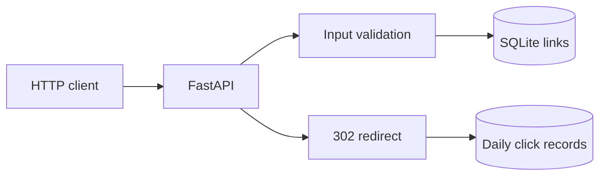
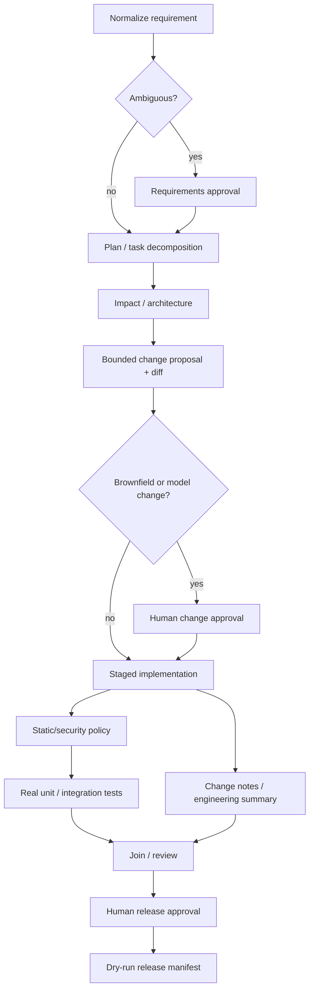

# Architecture and governance

## Service data flow

Create: validate URL/alias, generate secure random code, perform atomic insert with unique index, honor idempotency key. Redirect: look up link, check expiry/disabled, record best-effort analytics, redirect. Stats: aggregate recent click counts. Disable: soft-delete. Production growth path: PostgreSQL links + Redis cache + asynchronous event queue; authenticated API, anti-abuse policy and rate limiting.

## Mandatory orchestration graph

The **graph and approval gates are owned by the deterministic policy engine**, not by the model. Each task has explicit entry dependencies, terminal outcome and persisted execution record. Independent ready tasks execute in worker batches; review joins test/security/documentation evidence. The test stage waits for the security scan of the actual candidate before executing candidate code. Review and release cannot run while any prerequisite is pending or failed.

## Agent responsibilities and authority

| Agent | Inputs | Output | Authority |
|---|---|---|---|
| Intake | requirement, scenario | normalized specification, assumptions/ambiguities | interpret only |
| Plan | approved intake | plan and dependency narrative | propose subtasks, not change control graph |
| Design | plan + source inventory | module/API impact and trade-offs | inspect only |
| Proposal | requirement + allowlisted source | exact edits, tests, human-readable unified diff | propose, never apply |
| Implementation | approved proposal | isolated staged candidate + manifest | write candidate only |
| Security | staged source | AST policy/risks report | block unsafe candidate |
| Test | checked candidate | actual pytest result, diagnostic on failure | fixed test command only |
| Docs | staged change | change notes and final summary | write artifacts only |
| Review / release | all evidence + human approvals | review and dry-run manifest | never merge or deploy |

`--llm` enables a model to interpret, decompose, suggest impacted modules and generate concrete anchored edits and a regression test. A provider-neutral HTTPS JSON interface is used; deterministic validation enforces schemas, paths, anchors, Python AST rules, bounded response size and reviewed changes. Bounded offline scenario runners remain useful when no model endpoint is configured. The automated tests stub model responses to prove that actual model-proposed edits cannot execute before approval.

## Versioning, re-planning and recovery

`revise RUN_ID --requirement ...` increments the requirement version, revokes all approvals, rolls back the staged candidate and rebuilds the full DAG. `replan RUN_ID --changed-stage security` invalidates only that stage and its graph descendants, preserving independent completed outputs (e.g. documentation). At `advance`, completed output artifacts are fingerprinted; unexpected changes automatically invalidate the affected task and downstream approvals. This preserves freshness and decision lineage. Completed/failed/stopped runs are immutable terminal histories and require a new run.

Each agent stage is audited with duration, attempts, requirement version, and outcome. Failed test execution is retried once with bounded backoff; syntax compilation is an **informational diagnostic**, never an alternative passing gate. Failed or rejected work safe-stops and removes the isolated candidate. The source checkout remains unchanged. RunStore persists JSON state and SHA-256 chained events; it is a local demonstration of tamper evidence, not a signed append-only compliance system. Metrics: terminal success ratio, retry/rollback/replan counts, retry-recovery-time proxy, and end-to-end latency.

## Security and reliability boundaries

Pre-execution human review is mandatory for model-generated and brownfield patches; all releases require another human approval. Proposals cannot change orchestrator/CI policy files, cannot write arbitrary paths, cannot silently overwrite source, and cannot supply test shell commands. Tests run in a reduced-environment subprocess and cannot access model API credentials by normal environment inheritance. However **Python AST controls are incomplete security boundaries**: do not run arbitrary untrusted code without container isolation, restricted filesystem, network controls and separate credentials in production. Human actors currently are provided CLI names; use authenticated identity/roles and an independent audit sink in production.

## Core trade-offs

The local implementation deliberately favors reproducibility and reviewability over distributed scale. SQLite is suitable for demo durability, not multi-region redirect/analytics. Candidate-only rollback is safe but cannot revert a real deployment. Replanning is conservative for changed requirements and selective for independently changed upstream artifacts. The model can propose changes but cannot expand its own permissions. See `docs/DECISIONS.md` for the quality gates and rationale.
