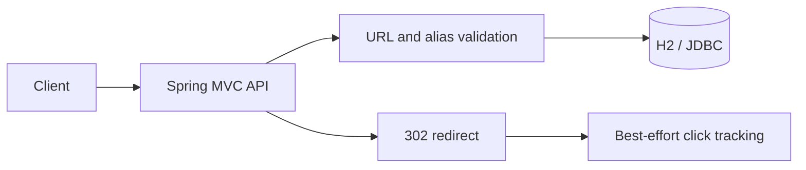
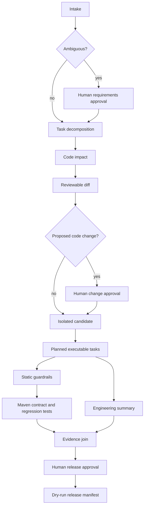

# Architecture and design decisions

## URL shortening

Create links in a database transaction with unique alias and idempotency constraints. Random codes use `SecureRandom`. Redirect reads the active link, rejects expired or disabled links, records a click and responds with HTTP 302. An analytics failure does not block the redirect.

For larger traffic, use an external relational database, a cache for hot short codes and a durable queue for click events. Authentication, rate limiting, abuse screening and operational monitoring are necessary before public deployment.

## Engineering workflow

The planner produces executable action nodes. Every task names a known action and may depend on earlier planned tasks. The engine inserts these nodes into the DAG and makes `security` and `docs` wait for their completion. Model-generated tasks cannot add approval bypasses or new executable action types.

The graph is persisted to H2 after execution batches. `advance` resumes from completed tasks and stops at a blocked human gate. Documentation and security can run concurrently. Review starts only when documentation, security and tests have completed successfully.

## Governance and recovery

A proposed source patch must match an allowlisted file and unique substring. The original file SHA-256 is recorded so the staged patch fails if its source changes before approval. Generated source and tests undergo restricted-string checks; this is not a complete Java security sandbox. A reviewer must approve proposed code changes before they are applied or executed.

Test execution uses a fixed Maven command, rather than a command supplied by a model. It has a bounded retry. Failures do not advance to release. Candidate-only rollback removes staged code after rejection, failure or safe-stop. Requirement revisions restart the graph and revoke approvals. Artifact fingerprint changes and targeted replanning invalidate dependent tasks while preserving independent work.

Runs and audit events are stored in H2. Events use a chained SHA-256 digest for local tamper evidence. The metrics endpoint reports success rate, retries, rollbacks, replans, elapsed workflow duration and retry-recovery-time proxy. These are useful prototype metrics, not a replacement for a compliance-grade audit sink or incident MTTR monitoring.

## Boundaries

The model client is optional and provider-neutral. Offline scenarios are deterministic for reproducibility; live mode can interpret requirements, generate executable task decompositions, identify affected files and propose changes with regression tests. The engine remains the authority for dependencies, allowed actions and approval gates.

Source code is staged under `artifacts/<run-id>/candidate` and never automatically committed, merged or deployed. The current proof of concept does not isolate arbitrary generated code with containers, authenticate approval actors or handle distributed workers. Those would be separate production steps.
